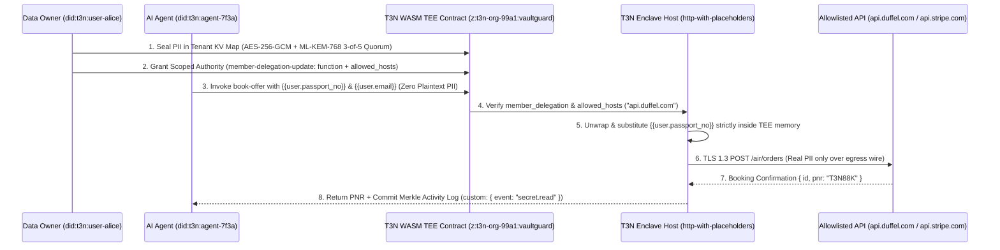

# T3-VaultGuard (`z:t3n-org-99a1:vaultguard`)

**Zero-Leak Confidential AI Agent Execution, Scoped Member Delegation & Reusable Smart VC Firewall built on the Terminal 3 (`T3N`) Agent Developer Kit (`@terminal3/t3n-sdk`)**

[](LICENSE)
[](contracts/t3n_enclave_executor/wit/world.wit)
[-06B6D4.svg)](src/t3_vaultguard/crypto.py)
[](tests/test_vaultguard.py)

- **Live Interactive Workbench (GitHub Pages):** [https://jeffrey-graham.github.io/t3-vaultguard-agent/](https://jeffrey-graham.github.io/t3-vaultguard-agent/)
- **Built for:** [Terminal 3 Build+Scale Agent Micro Grant on DoraHacks](https://dorahacks.io/hackathon/t3-build-scale-grant/detail)

---

## 1. Problem Statement

Enterprise AI agents that automate travel booking, cross-border treasury settlement, procurement, and institutional KYC routinely suffer from two fatal vulnerabilities:
1. **Plaintext PII & Credential Leakage in LLM Context Windows:** Conventional agents read raw passport numbers, corporate card PANs, tax IDs, and IBANs directly into the LLM prompt or tool-call history—exposing sensitive secrets to model providers, logs, and tracing pipelines.
2. **Prompt Injection Exfiltration:** A single untrusted email, PDF invoice, or web page can hijack an agent into POSTing secrets to an attacker-controlled webhook (`https://evil-webhook.attacker.io/exfil`).

---

## 2. How `T3-VaultGuard` Solves This on Terminal 3 (`T3N`)

`T3-VaultGuard` separates **AI agent reasoning** from **sensitive data execution** using the five core primitives of the **Terminal 3 Agent Developer Kit (`T3N ADK`)**:



### Key Architectural Components

1. **WASM TEE Enclave Contract (`contracts/t3n_enclave_executor/`)**:
   - Written in Rust targeting the `wasm32-wasip2` component model (`wit/world.wit`, `package z:tenant-vaultguard@0.4.2`).
   - Imports only explicit host capabilities (`host:tenant/tenant-context@1.2.0`, `host:interfaces/kv-store@2.2.0`, `host:interfaces/http-with-placeholders@2.2.0`).
2. **Post-Quantum Session & Storage Cryptography (`src/t3_vaultguard/crypto.py`)**:
   - Implements the **ML-KEM-768 (FIPS 203)** session key encapsulation flow, directional **HKDF-SHA256** session keys (`t3n-session-v1-c2s` and `t3n-session-v1-s2c`), **12-byte nonce `AES-256-GCM`** authenticated payload encryption, and **3-of-5 Shamir Threshold Quorum Key Recovery** over $GF(p)$.
3. **Scoped Member Delegation & Egress Host Firewall (`src/t3_vaultguard/enclave.py`)**:
   - Enforces `member-delegation-update` grants (`grantee: "did:t3n:agent-7f3a"`, `contract_id: "z:t3n-org-99a1:vaultguard"`, `function`, `allowed_hosts`, `allowed_placeholders`).
   - Any prompt-injection attempt to exfiltrate placeholders (`{{user.passport_no}}`, `{{user.card_no}}`) to a non-allowlisted domain (`evil-webhook.attacker.io`) is **aborted inside the TEE before key unwrap** and logged as `outcome: "denied"`.
4. **Reusable KYC Smart VC Zero-Knowledge Verifier**:
   - Verifies W3C Verifiable Credentials (`T3ReusableKycCredential`) issued by `did:key:terminal3` using selective-disclosure zero-knowledge predicates (`age_over_18`, `ofac_sanctions_clear`, `accredited_institutional_signer`) with `raw_pii_disclosed: false`.
5. **Tamper-Evident Merkle Activity Audit Trail (`client.getActivityLog()`)**:
   - Records every `secret.read`, `policy.update`, `tool.install`, and `tool.remove` event in a hash-chained Merkle tree with verifiable inclusion proofs.

---

## 3. Repository Structure

```text
t3-vaultguard-agent/
├── contracts/
│   └── t3n_enclave_executor/
│       ├── Cargo.toml               # Rust WASM TEE contract manifest (cdylib + rlib)
│       ├── wit/world.wit            # WIT capability imports (http-with-placeholders@2.2.0)
│       └── src/lib.rs               # Enclave placeholder resolver, host firewall & Merkle logger
├── src/
│   └── t3_vaultguard/
│       ├── __init__.py
│       ├── crypto.py                # ML-KEM-768 (FIPS 203), HKDF (c2s/s2c), AES-256-GCM, 3-of-5 Quorum
│       ├── enclave.py               # Sandboxed T3N Enclave, Member Delegation, Smart VCs & Merkle Audit Log
│       ├── mcp_server.py            # Model Context Protocol (MCP) server for zero-leak agent tool calls
│       └── sdk_bridge.ts            # TypeScript @terminal3/t3n-sdk integration helper
├── docs/
│   ├── index.html                   # Interactive 4-Panel Enterprise Governance Workbench (GitHub Pages)
│   ├── styles.css
│   └── app.js
├── tests/
│   └── test_vaultguard.py           # Automated pytest suite (10/10 passing)
├── screenshots/                     # High-resolution 1920x1080 workbench screenshots
├── logo.png                         # 512x512 project emblem
├── demo.mp4                         # 1920x1080 H.264 walkthrough video
└── LICENSE                          # MIT License
```

---

## 4. Quickstart & Verification

```bash
# 1. Run the automated Python test suite
PYTHONPATH=src pytest -v

# 2. Launch the interactive 4-panel workbench locally
python3 -m http.server 8080 --directory docs
# Open http://localhost:8080
```

---

## 5. License

Released under the [MIT License](LICENSE).
